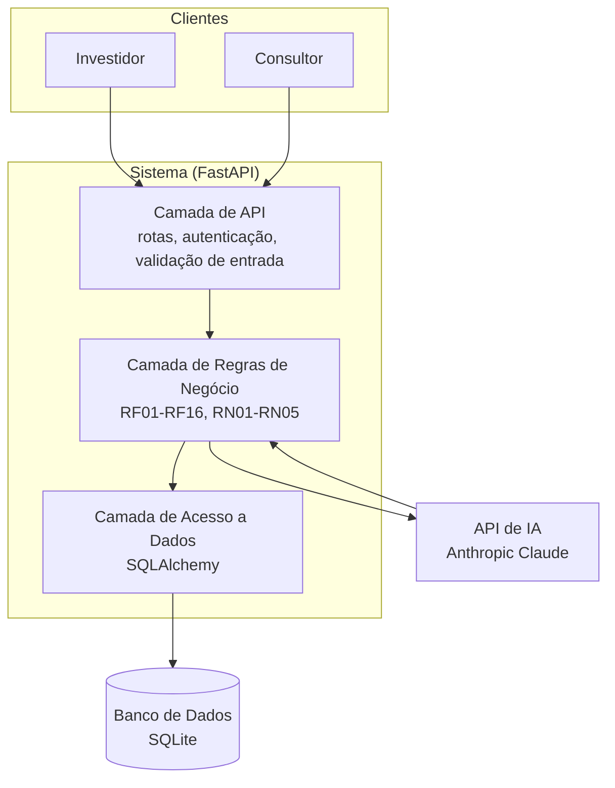

# Architecture.md — Arquitetura do Sistema

> Complementa o plan.md com o diagrama de componentes e as considerações de segurança exigidas na Entrega 3.

## 1. Diagrama de Componentes

**Leitura do diagrama:** o Investidor e o Consultor acessam o sistema exclusivamente pela Camada de API, que nunca fala diretamente com o banco de dados ou com a IA — toda decisão passa pela Camada de Regras de Negócio, que é quem valida RNs e aplica RFs. A API de IA só devolve dados estruturados; a própria camada de regras decide o que fazer com eles (RN04).

## 2. Escolhas Tecnológicas (recapitulação do plan.md)

| Camada | Tecnologia | Justificativa resumida |
|---|---|---|
| Linguagem / Framework | Python + FastAPI | Rapidez de desenvolvimento solo, documentação interativa automática (Swagger). |
| Banco de dados | SQLite + SQLAlchemy | Zero configuração, persistência real, migração futura sem reescrever o domínio. |
| IA / LLM | API da Anthropic (Claude) | Saída estruturada em JSON confiável para as regras RF14-RF16. |
| Testes | Pytest | Padrão de mercado, permite testar regras de negócio isoladas da API. |
| Autenticação | JWT (JSON Web Token) | Stateless, adequado a uma API REST sem necessidade de sessão no servidor. |

Os detalhes de cada decisão estão registrados nos ADRs correspondentes em `/docs/adr`.

## 3. Considerações de Segurança

- **Senhas:** armazenadas com hash (bcrypt), nunca em texto plano — cumpre RNF03.
- **Autorização por recurso:** cada rota valida se o usuário autenticado é dono do recurso solicitado (um Investidor não acessa carteira de outro; um Consultor só acessa Investidores vinculados a ele) — cumpre RNF04 e RN05. A verificação ocorre no backend, nunca apenas pela ocultação de botões na interface.
- **Proteção contra SQL Injection:** todo acesso ao banco passa pelo ORM (SQLAlchemy), que usa queries parametrizadas — nenhuma concatenação manual de SQL.
- **Validação de entrada:** o FastAPI usa Pydantic para validar tipos e formatos antes de qualquer dado chegar à camada de regras de negócio.
- **Segredos e chaves de API:** a chave da API da Anthropic é lida de variável de ambiente (`.env`, listado no `.gitignore`) e nunca é commitada no repositório.
- **Validação da resposta da IA:** antes de qualquer dado da IA ser aplicado à carteira, o schema do JSON retornado é validado — uma resposta malformada é descartada e registrada como erro, nunca aplicada (RNF08, RN04).
- **Tokens de sessão:** o JWT tem tempo de expiração definido, reduzindo o risco de uso indevido de um token vazado ou esquecido.
